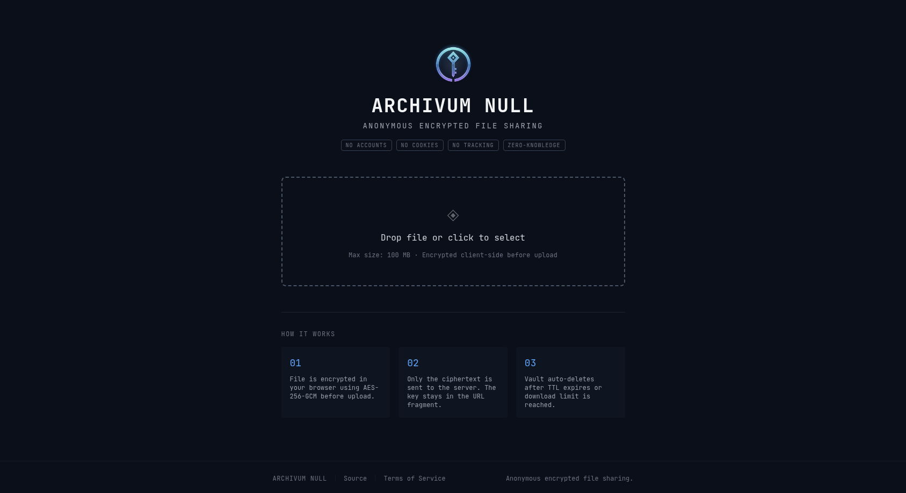
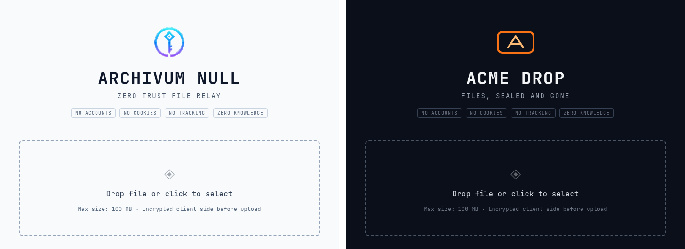

<div align="center">
    
    <br><br>
    
<br \><br \>

# Archivum Null

Anonymous encrypted file sharing for privacy-first users — zero-knowledge, no accounts, self-hostable.

<br />

[](https://github.com/whiteravens20/archivum-null/actions/workflows/test.yml)
[](https://github.com/whiteravens20/archivum-null/actions/workflows/docker-snapshot.yml)
[](https://github.com/whiteravens20/archivum-null/actions/workflows/release.yml)
[](https://github.com/whiteravens20/archivum-null/actions/workflows/codeql.yml)
[](https://github.com/whiteravens20/archivum-null/actions/workflows/security.yml)
[](https://scorecard.dev/viewer/?uri=github.com/whiteravens20/archivum-null)

<br />


</div>



**Why this exists:** Firefox Send is gone, croc and Magic Wormhole need a CLI on both ends, and most "secure" web uploaders ask you to sign in. Archivum Null is browser-only, account-free, end-to-end encrypted in the page, and self-hostable on a $5 VPS or a homelab box.

---

## Try It Now

**Working demo:** [archivum.wrservices.link](https://archivum.wrservices.link) — share a file in seconds, no install, no signup. The demo runs the same image you'd self-host; uploads expire automatically.

Or spin it up locally in one command — requires only Docker:

```bash
git clone https://github.com/whiteravens20/archivum-null.git
cd archivum-null
docker compose -f docker-compose.quickstart.yml up -d
```

Then open **http://127.0.0.1:3000** in your browser.

> ⚠️  This uses a default admin password (`quickstart-change-me`). Change it before any real use — see [Production](#production) for the full hardening checklist.

---

## Prerequisites

There are two supported paths:

1. **Docker demo** above — fastest way to see it run.
2. **Local Node.js dev** — clone the repo and run backend + frontend with `npm run dev`. No Docker required.

The table below lists the only hard requirement and optional conveniences.

### Required (always)

| Requirement | Notes |
|---|---|
| Node.js 24+ | Both backend and frontend; declared in each `package.json` |

### Optional — containerised setup

| Option | Notes |
|---|---|
| Docker 24+ & Docker Compose | Convenient wrapper around Node — not required; use if you prefer containers or want the production image |

### Recommended for public / production deployment

| Recommendation | Why it matters if skipped |
|---|---|
| Domain name pointed at a public IP | Without one, the service is reachable only on a local network or raw IP — fine for personal/homelab use |
| VPS running a reverse proxy (nginx, Caddy, …) | Without TLS termination, traffic is unencrypted in transit; the browser will block WebCrypto on non-HTTPS origins (see [Troubleshooting](#troubleshooting)) |
| Private tunnel (WireGuard, SSH, VPN overlay) | Without a tunnel, port 3000 must be exposed directly to the internet — significantly higher attack surface |
| Cloudflare Turnstile | Without it, upload abuse protection relies on rate limiting alone; Turnstile verification is automatically skipped when keys are not set |

> **Quickest local start:** `cd backend && npm install && STORAGE_PATH=../data/vaults npm run dev` in one terminal, `cd frontend && npm install && npm run dev` in another. Open `https://localhost:5173` (accept the self-signed cert once — required for WebCrypto).

## Architecture

Everything that touches your file in readable form happens in the browser. When you pick a file, the page generates a fresh AES-256-GCM key with the WebCrypto API and encrypts the file as a stream of 5 MB chunks. Each chunk gets its own IV and is bound to its position — its index and whether it is the last one — so the server cannot reorder, drop or append chunks without decryption failing. The original filename and MIME type are encrypted inside the blob too.

Only the ciphertext is uploaded, over HTTPS, together with the vault settings (expiry and download limit). In return you get a link of the form `/vault/{id}#KEY.FILENAME`. The key sits after the `#`, and browsers never send that part of a URL to the server, so the key reaches the recipient only through the link you share.

The server is a relay that cannot read what it relays. For each vault it keeps the vault ID, the encrypted blob, when it was created and when it expires, and how many downloads it allows and has left. It never sees the plaintext, the key, the real filename or MIME type, or who uploaded the file, and it keeps no log of client IP addresses — rate limiting counts requests in memory only. When a vault expires or runs out of downloads, the blob and its metadata are deleted.

## Development Setup

```bash
# Clone
git clone https://github.com/whiteravens20/archivum-null.git
cd archivum-null

# Install dependencies
cd backend && npm install && cd ..
cd frontend && npm install && cd ..

# Start backend
cd backend && STORAGE_PATH=../data/vaults npm run dev &

# Start frontend
cd frontend && npm run dev
```

Run this way, the backend takes its settings from the environment and does not read `.env`. `STORAGE_PATH` points it at the repository's ignored `data/` directory; the default, `/data/vaults`, is the path inside the container image. Any other variable goes in front of the command the same way, for example `ADMIN_PASSWORD=dev` to open the admin panel.

Or with Docker:

```bash
cp .env.example .env
docker compose -f docker-compose.dev.yml up --build
```

Frontend: `https://localhost:5173` (self-signed cert — accept the browser warning once)
Backend API: `http://localhost:3000`

Both are published on this machine only; start with `DEV_BIND_ADDRESS=0.0.0.0` in front of the command to reach them from another device on your network. The containers run as a non-root user and get `backend/src`, `frontend/src` and `frontend/public` read-only, so they reload what you edit and cannot write into your working tree. Dependencies are installed when the images are built: run the command again, with `--build`, after changing a `package.json`, a lockfile, a config file or `index.html`.

The frontend uses HTTPS because WebCrypto refuses to run on insecure origins; the backend stays on HTTP because Vite's dev proxy handles the bridge. In production both sit behind your reverse proxy on TLS.

## Production

> **First-time deploy checklist** — complete in order.

**1. Provision the VPS.** Install nginx or Caddy. Open ports 80 and 443 only. Keep port 3000 closed (see [VPS Hardening](docs/HARDENING.md#vps-hardening)).

**2. Set up a private tunnel.** WireGuard is recommended — see [WireGuard — Prevent Lateral LAN Movement](docs/HARDENING.md#wireguard--prevent-lateral-lan-movement). Note the tunnel IP assigned to your homelab machine (e.g. `10.8.0.2`).

**3. Configure DNS.** Point your domain `A` record to the VPS public IP.

**4. Clone the repo** on the homelab host.

```bash
git clone https://github.com/whiteravens20/archivum-null.git
cd archivum-null
cp .env.example .env
```

**5. Edit `.env`.** Minimum required changes:

```bash
ADMIN_PASSWORD=<a-strong-random-password>   # required — panel locked without this
HOST_BIND_ADDRESS=<tunnel-ip>              # e.g. 10.8.0.2 — your homelab WireGuard IP
# Uncomment and fill in if using Cloudflare Turnstile:
# TURNSTILE_SECRET=<your-cf-secret>
# TURNSTILE_SITE_KEY=<your-cf-site-key>
# Set in step 7, once the reverse proxy is in place:
# TRUST_PROXY=<address-the-proxy-connects-from>
```

**6. Start** the production container (pull prebuilt image — no local build needed).

```bash
docker compose pull && docker compose up -d
```

> To build locally from source instead: `docker compose up -d --build`

**7. Configure the reverse proxy** on the VPS — copy the config for your proxy from [Reverse Proxy Configuration](docs/HARDENING.md#reverse-proxy-configuration). Replace `<TUNNEL_IP>` with your homelab tunnel IP. Then set `TRUST_PROXY` in `.env` to the address the proxy connects from, as the security note under that config describes, and run `docker compose up -d` again. Until it is set, the app ignores the proxy's `X-Forwarded-For` and all visitors share one rate-limit bucket.

**8. Contain the app, then validate the deployment posture**, both on the homelab host. The first command stops the container from opening connections of its own and lets only the tunnel interface reach it; `--turnstile yes` if you set the Turnstile keys. The second checks the result. See [Egress Containment](docs/HARDENING.md#egress-containment) for what the rules do.

```bash
sudo bash scripts/setup-firewall.sh --mode docker --turnstile no --tunnel-iface wg0 --persist
sudo ./scripts/check-deployment.sh --tunnel-iface wg0
```

All checks should pass before exposing the service publicly.

## Environment Variables

All variables live in a single `.env` file at the project root. Copy `.env.example` to get started.

Most deployments only touch the variables below. For the full reference (chunk sizes, rate limit tuning, Turnstile hostname pinning, etc.), see [docs/CONFIGURATION.md](docs/CONFIGURATION.md). To change the name, colours or logo, see [Branding](#branding).

| Variable | Default | Description |
|---|---|---|
| `ADMIN_PASSWORD` | — | Admin panel password (**required** — service refuses to start without it) |
| `HOST_BIND_ADDRESS` | `127.0.0.1` | Docker host interface for the published port. Set to your tunnel/WireGuard IP in production — never `0.0.0.0` on a public host. |
| `MAX_FILE_SIZE` | `104857600` | Max upload size in bytes (100 MB) |
| `DEFAULT_TTL` / `MAX_TTL` | `86400` / `604800` | Default and maximum vault lifetime in seconds (24 h / 7 d) |
| `MAX_TOTAL_STORAGE` | `0` (unlimited) | Global storage quota in bytes; new uploads return HTTP 507 over this limit. Unlimited means uploads can fill the disk the vaults are on, which with Docker is the host's own. `.env.example` sets 10 GiB. |
| `TURNSTILE_SITE_KEY` / `TURNSTILE_SECRET` | — | Cloudflare Turnstile keys — when both are unset, CAPTCHA is skipped |
| `TRUST_PROXY` | `loopback` | Addresses your reverse proxy connects from (IPs, CIDR ranges, `loopback` / `linklocal` / `uniquelocal`). `X-Forwarded-For` is honoured only from these. Listing more than the proxy lets clients spoof their IP and bypass rate limiting. A hop count is rejected at startup. |
| `UPDATE_CHECK_ENABLED` | `false` | Compare the running version against the newest GitHub release in the admin panel. Opt-in — the app's only self-initiated outbound connection |
| `APP_VERSION` | — | Version shown in the admin panel. Set automatically in Docker images and by the LXC installer; a manual source install has to set it |

## Deployment Architecture

### Production Mode (Secure Homelab)

Visitors connect to a small VPS, which holds the public IP, terminates TLS and runs nothing but a reverse proxy (nginx, Caddy, …). The proxy forwards requests over a private tunnel — WireGuard, an SSH tunnel or a VPN overlay — to the homelab host or VM that actually runs Archivum Null. That host listens only on its tunnel interface, so the app and the stored vaults are never exposed directly to the internet or the LAN.

**Key requirements:**
- Docker port published **only** on the tunnel interface IP (`HOST_BIND_ADDRESS=<tunnel-ip>` in `.env`)
- No direct LAN access to port 3000
- Container runs as non-root with read-only filesystem and all capabilities dropped
- VPS exposes only ports 80 and 443 — port 3000 is never public

For the full hardening guide — inbound firewall rules, reverse proxy config (nginx/Caddy), VPS lockdown, WireGuard scope, and egress containment — see **[docs/HARDENING.md](docs/HARDENING.md)**.

To apply the firewall rules, interactively:

```bash
sudo bash scripts/setup-firewall.sh
```

### Proxmox LXC Deployment

Running Archivum Null as a Proxmox LXC container is a lightweight alternative to a full VM. No Docker is needed — Node.js runs directly inside the LXC.

The installer creates an unprivileged container, installs the newest release in it, and runs the app as its own user under a sandboxed systemd unit. It asks for the address of your reverse proxy and writes a Proxmox firewall file that lets only that address in and drops what the container sends out.

For full instructions covering the installer, a way to check the script before you run it as root, manual installation, the service unit, updating, the Proxmox firewall, and SDN/VLAN isolation, see **[docs/PROXMOX.md](docs/PROXMOX.md)**.

**Quick start (Proxmox host shell):**

```bash
bash -c "$(wget -qLO - https://github.com/whiteravens20/archivum-null/raw/main/scripts/install-lxc.sh)"
```

**Update existing LXC** to the newest release. An install made by an earlier version of the installer, which ran the app as root, is migrated by the same command:

```bash
bash -c "$(wget -qLO - https://github.com/whiteravens20/archivum-null/raw/main/scripts/install-lxc.sh)" -- --update <vmid>
```

### Deployment Validation

After bringing up the production container on the homelab host and applying the firewall rules, run the included validation script:

```bash
sudo ./scripts/check-deployment.sh --tunnel-iface wg0
```

It checks:
- Container is running and healthy
- Port 3000 is **not** bound to every interface, IPv6 included
- Container is running as non-root and is not privileged
- All capabilities are dropped, `no-new-privileges` is active, the seccomp and AppArmor profiles are on
- Root filesystem is read-only
- No host namespace is shared, and process and memory limits are set
- Tunnel interface is up and its IP matches `HOST_BIND_ADDRESS`
- The egress rules are loaded and the inbound guard is in place
- The container **cannot** open a connection to the internet or to the host: it is made to try
- Port 3000 is **not** published on the LAN address
- `docker.sock` is not mounted inside the container

## Docker Images

Images are published to `ghcr.io/whiteravens20/archivum-null`.

| Tag | Source | Stable | Purpose |
|---|---|---|---|
| `:1.2.3` / `:1.2` / `:1` | Tagged release from `main` | ✅ Yes | Production — pin to an exact version |
| `:main` | Rolling pointer to the latest tagged release on `main` | ✅ Yes | Production — auto-rolls forward; use this if you want unattended updates instead of a pinned version |
| `:latest` | Alias of `:main`, pushed by the same release job | ✅ Yes | Production — identical image and digest to `:main` |
| `:edge` | Snapshot build, run by hand from `main` | ⚠️ No | Snapshot — preview of next release, not production-ready |
| `:dev` | Snapshot build, run by hand from `dev` | ❌ No | Snapshot — development builds, may be broken |
| `:edge-<sha>` / `:dev-<sha>` | Specific commit | — | Pin to a known-good snapshot |

> **Only `:main`, `:latest` and versioned tags (`:1.2.3`) are production-ready builds.** They are published exclusively by the release workflow on a semver tag push from `main`.
> `:latest` usually earns its bad reputation by meaning "the last image built". It cannot mean that here: the release workflow only ever runs on a semver tag, and snapshots are pushed under `:dev` / `:edge` by a different workflow. So `:latest` is simply another name for `:main` — same image, same digest.
> `:edge` and `:dev` are CI snapshot builds — do not use them for any internet-facing deployment.

## Upgrading

**From a registry image (recommended for CD deploys):**
```bash
# Pin to a specific version by setting IMAGE_TAG=1.2.3 in .env first,
# then pull and restart:
docker compose pull
docker compose up -d
docker image prune -f
```

**From source (local build):**
```bash
git pull
docker compose up -d --build
```

The `vault-data` volume is preserved across both modes. Check the release notes for breaking changes before upgrading.

**Checking what you deploy.** Every release image carries a signed build provenance. On any machine with the [GitHub CLI](https://cli.github.com/):

```bash
gh attestation verify oci://ghcr.io/whiteravens20/archivum-null:1.2.3 --repo whiteravens20/archivum-null
```

It exits with an error for an image that this repository's release workflow did not build. A tag can be moved after you checked it; a digest cannot. To run exactly the image you verified, put its digest behind the tag in `.env`:

```bash
docker buildx imagetools inspect ghcr.io/whiteravens20/archivum-null:1.2.3 --format '{{json .Manifest.Digest}}'
# .env
IMAGE_TAG=1.2.3@sha256:<the digest printed above>
```

## Troubleshooting

| Symptom | Cause | Fix |
|---|---|---|
| Port 3000 still bound to `0.0.0.0` | `HOST_BIND_ADDRESS` not set in `.env` | Set `HOST_BIND_ADDRESS=<tunnel-ip>` and `docker compose up -d` |
| Health check failing | `PORT` mismatch between app and health check | Ensure `PORT` in `.env` matches `HEALTHCHECK` in `Dockerfile` (default: `3000`) |
| Admin panel returns 403 | `ADMIN_PASSWORD` empty or not set | Set `ADMIN_PASSWORD` in `.env` and restart |
| Uploads fail with 413 | The reverse proxy's request size limit is at or below `CHUNK_SIZE` | Set it above `CHUNK_SIZE`: `15m` for the default 10 MB — see the nginx/Caddy config examples |
| Turnstile always fails | Site key / secret key mismatch | Ensure `TURNSTILE_SITE_KEY` matches the Cloudflare dashboard and both `TURNSTILE_SECRET` and `TURNSTILE_SITE_KEY` are set |
| Files not persisted after restart | Volume not mounted | Check `vault-data` volume exists: `docker volume ls` |
| Permission denied writing to `/data/vaults` | Bind mount used instead of named volume, wrong ownership on host | Named volumes handle ownership automatically. If using a bind mount, the host directory must be owned by UID `1001`: `sudo chown 1001:1001 /your/path` |
| `crypto.subtle is undefined` in browser | Page served over plain HTTP | WebCrypto requires a secure context (HTTPS or `localhost`). In dev, use `https://localhost:5173` |

## Tech Stack

| Layer | Technology |
|---|---|
| Frontend | React, TypeScript, Vite, TailwindCSS |
| Backend | Fastify (Node.js), TypeScript |
| Encryption | WebCrypto API, AES-256-GCM |
| Storage | Local disk (abstracted) |
| Anti-abuse | Cloudflare Turnstile, in-memory rate limiting |
| Container | Docker, Alpine-based, multi-stage build |

## Admin Panel

Accessible at `/admin`. Protected by HTTP Basic Auth.

Capabilities:
- View active vault count, storage usage, and status
- List vault metadata (ID, size, timestamps, download counts)
- Force delete any vault
- Health check on API
- Report the running version and uptime, and — when enabled — flag a newer release with a link to the changes

**Does NOT expose:** encryption keys, plaintext, or uploader identity.

Set `ADMIN_PASSWORD` in `.env` to enable. For production, additionally protect it behind a tunnel or an IP allowlist at the reverse proxy; the [nginx and Caddy examples](docs/HARDENING.md#reverse-proxy-configuration) carry one for `/admin` and `/api/admin`.

### Update notifications

The panel always shows which version the instance runs. Comparing it against the
newest GitHub release is **opt-in**, because it is the only outbound connection the
app ever makes on its own and [docs/HARDENING.md](docs/HARDENING.md#egress-containment)
tells you to block exactly that:

```bash
UPDATE_CHECK_ENABLED=true
```

When a newer release exists the panel shows a notice with links to the GitHub compare
view and the release notes. The check runs at most every 6 hours, sends nothing that
identifies the deployment, and fails quietly if egress is blocked. Full details in
[docs/CONFIGURATION.md](docs/CONFIGURATION.md#version--update-check).

> Docker images carry their version automatically. **Bare-metal installs must set
> `APP_VERSION`** or the panel reports `unknown`.

Applying an update is still up to your deployment. `docker compose up -d` on its own
reuses the local image — run `docker compose pull` first. If you use Watchtower with
`WATCHTOWER_LABEL_ENABLE=true`, the container needs the opt-in label or it is silently
never updated; see
[HARDENING.md → Keeping the deployment current](docs/HARDENING.md#keeping-the-deployment-current).

The version is deliberately **not** exposed to unauthenticated callers — see
[HARDENING.md → Version Disclosure](docs/HARDENING.md#version-disclosure) for what
that means for your reverse proxy config.

## Cloudflare Turnstile

To enable:
1. Create a Turnstile widget at [dash.cloudflare.com](https://dash.cloudflare.com)
2. Set `TURNSTILE_SITE_KEY` in `.env`
3. Set `TURNSTILE_SECRET` in `.env`

When secrets are default/missing, Turnstile verification is skipped, and the page never contacts Cloudflare. With Turnstile enabled, the visitor's browser requests the Turnstile script only on the upload form, once a file is selected; opening a vault link, the terms or any other page does not.

When the server verifies a token, it sends Cloudflare the visitor's address with it, which ties the token to the address that solved the challenge. Cloudflare receives the same address from the visitor's browser when the challenge is shown.

When Turnstile is enabled, the upload stays blocked until the widget verifies. If it has not done so within 10 seconds of file selection, the page says so and keeps waiting: an interactive challenge can take longer. An error is shown only when the widget itself reports a failure or the challenge expires.

## Branding

An instance can carry its own name, tagline, accent colour, logo and icons, and can use a light theme or follow the visitor's system setting. All of it is set in `.env` and an optional `branding/` directory, so the published image is used as it is:

```bash
BRAND_NAME=Acme Drop
BRAND_TAGLINE=Files, sealed and gone
BRAND_ACCENT_COLOR=#F97316
BRAND_THEME=auto
```



Branding is cosmetic only: no setting takes a URL, nothing is loaded from another origin, and no security header changes. [docs/BRANDING.md](docs/BRANDING.md) lists every setting and the file names the server looks for.

## Security

See [SECURITY.md](SECURITY.md) for the full security checklist.

### Key Guarantees

- **Zero-knowledge:** Server cannot decrypt uploaded files
- **No identity:** No accounts, cookies, or tracking
- **Ephemeral:** Vaults auto-delete after TTL or download limit
- **No persistent IP logs:** Rate limiter uses in-memory only
- **Authenticated encryption:** AES-256-GCM provides confidentiality + integrity
- **Filename sanitization:** Client strips path traversal sequences, control characters, bidirectional overrides, and zero-width Unicode trickery from filenames before use
- **Filename mismatch detection:** On download, the decrypted filename is compared to the one encoded in the URL fragment — a mismatch triggers a tamper warning

### What the Server Knows vs. Cannot Know

| The server stores | The server **cannot** know |
|---|---|
| Encrypted ciphertext | Plaintext content |
| Vault ID (random) | Encryption key (never sent) |
| File size (encrypted blob size) | Original filename (stored encrypted) |
| MIME type (stored encrypted) | Original MIME type |
| Created / expires timestamps | Uploader identity (no accounts) |
| Download count | Persistent IP address (in-memory only) |

This is the zero-knowledge guarantee: **a server compromise exposes only encrypted blobs, not plaintext.** The decryption key exists only in the vault URL fragment (`#`), which browsers do not include in HTTP requests.

### Threat Model — What We Protect Against

| Threat | Protection |
|---|---|
| Passive network observer | TLS in transit; ciphertext at rest — observer sees encrypted bytes only |
| Legal demand / server seizure | Only ciphertext + metadata available; operator cannot decrypt |
| Enumeration / brute-force | Vault IDs are 24-character nanoid (144 bits of entropy) |
| Abuse / spam | Turnstile CAPTCHA + four-tier rate limiting per IP |
| Filename spoofing / path traversal | Client-side `sanitizeFilename()` strips path separators, control chars, bidi overrides, zero-width chars, and leading dots; mismatch detection warns when the decrypted filename differs from the one in the link |
| Large file DoS | Streaming size enforcement — no full file held in memory |
| Admin credential theft | Timing-safe comparison; Basic Auth over TLS |
| Compromised container initiating outbound LAN/WAN connections | Host firewall rules drop every connection the container opens, to the LAN, to the Docker host and to the internet; `scripts/setup-firewall.sh` applies them, see [Egress Containment](docs/HARDENING.md#egress-containment) |

### Threat Model Limitations

| Threat | Why we don't mitigate it |
|---|---|
| Compromised client device | Key is in browser memory and visible in the URL bar/history |
| Malicious browser extension | Extensions can read page content and URL fragments |
| Link interception | Anyone with the vault URL can decrypt — share via encrypted channels |
| Compromised server serving modified JS | A compromised server could serve a client that exfiltrates the key |
| Targeted state-level adversary with client access | Outside scope — use dedicated offline encryption tools |
| DDoS at scale | Rate limiting covers casual abuse; use Cloudflare or a CDN for sustained attacks |

## Terms of Service

The TOS lives in [TOS.md](TOS.md) at the repository root. The backend converts it from Markdown to HTML once, at startup, and serves the result at `/api/tos`; the frontend shows it at the `/tos` route. Raw HTML in the file is shown as text, and links are kept to web and mail addresses and to paths on the site. Restart after editing the file.

> **Legal notice:** The included TOS is a placeholder template and does not constitute legal advice. Consult a qualified lawyer before deploying a public service.

## Zero-Knowledge Disclaimer

Archivum Null is a **zero-knowledge relay** — the following is built into the architecture:

- The server **never receives** the encryption key. The key exists only in the vault URL fragment (`#KEY`), which browsers exclude from HTTP requests.
- The server **stores only ciphertext**. Even with full server access, an attacker or the operator cannot read the file contents.
- The operator **cannot comply** with a request to reveal file contents. They can provide only: encrypted ciphertext, vault metadata (size, timestamps), and download counts.

> This guarantee holds **only** when the client device and browser are not compromised, and only when the vault URL is shared securely. See [Threat Model Limitations](#threat-model-limitations) above.

## Operator Pre-Launch Checklist

Before exposing this service publicly:

- [ ] Replace [TOS.md](TOS.md) with a legally reviewed document for your jurisdiction
- [ ] Add your contact information to TOS.md (`Replace with your contact information`)
- [ ] Set a strong `ADMIN_PASSWORD` — never leave it as the default
- [ ] Set `HOST_BIND_ADDRESS` to your tunnel IP — never expose port 3000 publicly
- [ ] Set `MAX_TOTAL_STORAGE` to what the disk under the vaults can spare — without it, uploads are limited only by that disk
- [ ] Apply the egress containment rules with `scripts/setup-firewall.sh`, with `--turnstile yes` only if Turnstile is on (see [Egress Containment](docs/HARDENING.md#egress-containment))
- [ ] Run `sudo ./scripts/check-deployment.sh` and confirm all checks pass
- [ ] Review the [Threat Model Limitations](#threat-model-limitations) and confirm they are acceptable for your use case

## Contributing

Contributions are welcome! Please read [CONTRIBUTING.md](CONTRIBUTING.md) for coding guidelines, testing requirements, and the secure contributing checklist before opening a pull request.

## Code of Conduct

This project follows the [Contributor Covenant](CODE_OF_CONDUCT.md). By participating, you are expected to uphold this code.

## How the code is written and checked

Archivum Null is built using AI coding tools. The tools write most of the code, tests and documentation; the maintainer decides what gets built and is responsible for everything that is merged. The project relies on checks that anyone can inspect, and before a release is published a group of human testers tries the release candidate at the maintainer's request.

**What a change goes through**

- Every push and pull request runs lint with no warnings allowed, type checking, a build and the unit tests of the backend and the frontend. Beside them, the Docker image is built, the shell scripts go through ShellCheck, and the firewall script is applied to a real container on the runner and probed. A pull request is merged only after all of it passes ([test.yml](.github/workflows/test.yml)).
- CodeQL, `npm audit` and Trivy scans of the repository and of the image run on every push and pull request, and again every week ([codeql.yml](.github/workflows/codeql.yml), [security.yml](.github/workflows/security.yml)).
- Pull requests other than automated dependency updates also get an automated review by an AI reviewer that looks for security, correctness and supply-chain problems. It is an extra check, not one of the gates.
- Commits are signed, and the [OpenSSF Scorecard](https://scorecard.dev/viewer/?uri=github.com/whiteravens20/archivum-null) results are public.

**What the maintainer decided and read**

- The security design was specified by the maintainer rather than left to a tool's defaults: AES-256-GCM in the browser, the key only in the URL fragment, no plaintext on the server.
- The [threat model](#threat-model--what-we-protect-against) and its [limitations](#threat-model-limitations) are the maintainer's own assessment.
- These modules are read line by line by the maintainer whenever they change: `frontend/src/crypto/encrypt.ts`, `backend/src/middleware/basicAuth.ts`, `backend/src/storage/local.ts` (the path traversal guard) and the vault expiry logic in `backend/src/vault/manager.ts`.

If something looks wrong, open an issue. For a vulnerability, follow [SECURITY.md](SECURITY.md).

## License

See [LICENSE](LICENSE) and [ATTRIBUTION](ATTRIBUTION.md).
